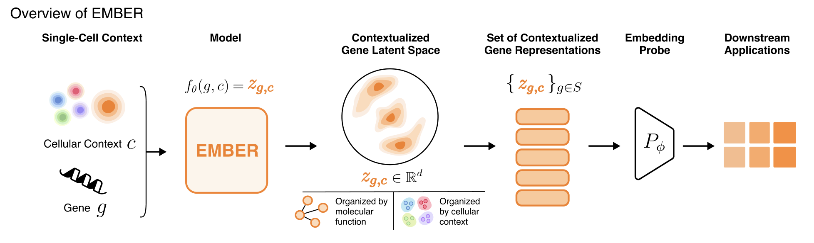
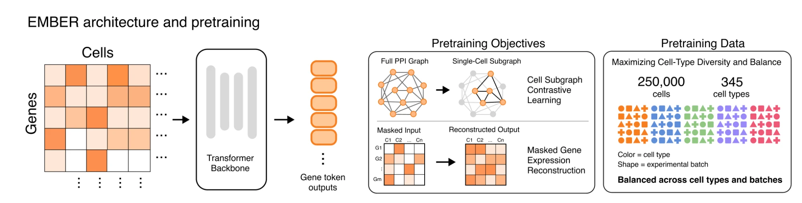
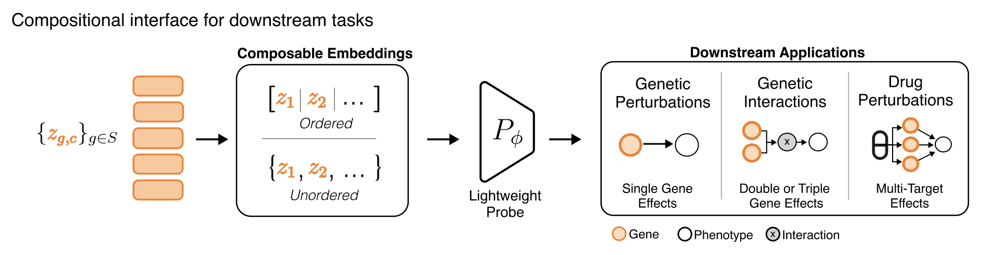

# Ember

<p align="center"></p>

EMBER is a gene-centric foundation model that learns context-dependent gene representations from single-cell RNA-seq. Use these embeddings for any gene related task! This repository provides the pretraining recipe, embedding extraction and the six benchmark evaluations from the paper.

```
Ember/
├── pretrain.py                 # (1) pretraining            configs/pretrain/*.yaml
├── extract_embeddings.py       # (2) checkpoint -> embeddings pickle
├── evaluate.py                 # (3) evaluation             configs/eval/*.yaml (evaluator: pairs | drug)
├── ember/                      # model, data, trainer, checkpoint loading, eval library
├── scripts/                    # download_data.sh, run_*.sh drivers
├── tasks/<task>/               # split definitions (+ downloaded task data)
├── graphs/                     # STRING PPI edge list used for pretraining
└── data/                       # smoke-test cells; downloaded pretraining / control data
```

## Installation

Requires [uv](https://docs.astral.sh/uv/) and, for training, a CUDA 12.6-capable GPU
(the evaluation and extraction scripts also run on CPU).

```bash
git clone https://github.com/NickDST/Ember.git && cd Ember
./install.sh                     # = uv sync --extra dev --extra plot
source .venv/bin/activate
```

This creates `.venv/` with Python 3.12, PyTorch 2.9.1 (cu126) and the pinned
dependencies in `uv.lock`, and installs `ember` in editable mode. For a CPU-only
torch build, remove the `[tool.uv.index]` / `[tool.uv.sources]` blocks from
`pyproject.toml` before installing.

**Smoke test** (10 cells, CPU, ~1 min; the loss should fall steadily):

```bash
python pretrain.py --config-name overfit_smoke
pytest tests/
```

## Data

Everything that is not in git is in the Ember data release on the Hugging Face Hub
(`NickDST/EMBER-data`). `scripts/download_data.sh` fetches it by component:

```bash
./scripts/download_data.sh checkpoint controls tasks   # default: everything but pretraining data
./scripts/download_data.sh pretrain                    # cxg_250K_{train,val}.h5ad (~4 GB)
./scripts/download_data.sh embeddings                  # precomputed embeddings from the paper (~1 GB)
```

| Component | Contents | Needed for |
|---|---|---|
| `checkpoint` | `checkpoints/ember_base/ember_base.pt` + `config.yaml` — the released model | extraction |
| `pretrain` | `data/cxg_250K_train.h5ad`, `data/cxg_250K_val.h5ad` | pretraining |
| `controls` | `data/controls/*.h5ad` — control cells for each benchmark's cell lines | extraction |
| `tasks` | task CSVs / atlases under `tasks/<task>/` | evaluation |
| `embeddings` | `gene_embeddings/{ember,baselines}/*.pkl`, linked into `embeddings/` — the Ember and baseline embeddings evaluated in the paper | evaluation without extraction |

See `data/README.md` and each `tasks/<task>/README.md` for file schemas. The
STRING graph (`graphs/`), the 10-cell smoke-test file and all split definitions
(`tasks/*/*_split.json`, `genes_eval.txt`, `drug_lookup.csv`) are tracked in git.

## 1. Pretraining

<p align="center"></p>

```bash
python pretrain.py                                        # configs/pretrain/ember_base.yaml
python pretrain.py name=my-run data.batch_size=128        # Hydra CLI overrides
python pretrain.py training.load_from_checkpoint=true     # resume from checkpoints/<name>/milestone.txt
```

**Inputs:** an h5ad of raw counts with gene symbols in `var[data.gene_name_col]`,
an optional validation h5ad with the same genes, and a `gene1,gene2` PPI edge list.

**Outputs** (in `checkpoints/<name>/`): `checkpoint_epoch_N.pt`, `config.yaml`,
`gene_vocab.tsv`, and `log_train.csv` / `log_val.csv` loss curves. Set
`wandb.enabled=true` (`uv sync --extra wandb`) to also log to Weights & Biases.

## 2. Extracting contextual gene embeddings

```bash
python extract_embeddings.py \
    --checkpoint checkpoints/ember_base/ember_base.pt \
    --h5ad data/controls/tahoe_controls.h5ad --group-col cell_line \
    --n-samples 2 --out embeddings/ember_base_tahoe.pkl
```

Every cell is tokenised exactly as in pretraining (no masking), and the per-gene
outputs are averaged over all cells of a group and over `--n-samples` context
re-samplings. The result is a pickle `embeds[group][gene_symbol] -> float32[128]`.

- `--group-col` takes groups from an `obs` column; `--group-const` assigns one
  label per `--h5ad` file (several files can be combined into one pickle).
- `--gene-col` selects a `var` column with symbols (default `var_names`);
  `--filter-col/--filter-value` keep a subset of cells (e.g. non-targeting controls).
- Genes outside the model vocabulary are dropped before tokenisation.
- `.X` must hold **raw counts**; a housekeeping-gene alignment check
  (`ember/alignment.py`) refuses matrices whose gene labels look scrambled.

`scripts/run_extract_all.sh` runs the four extractions used by the benchmarks.

## 3. Evaluation

<p align="center"></p>

Each benchmark has one Hydra config in `configs/eval/` with the task definition
in its header comment; its `evaluator` key (`pairs` or `drug`) selects the driver
inside the single `evaluate.py` entry point. Embeddings are read from
`embeddings/<embed_name>.pkl` (override with `embed_path=...`); results are
written to `tasks/<task>/results[/<cell_line>]/<embed_name>_*.csv`.
`./scripts/download_data.sh embeddings` provides every Ember and baseline
embedding from the paper under these names (e.g. `ember_base_lincs`,
`scgpt_pan_cancer_lincs`); the `ember-data` README lists them.

| Task | Config | `evaluator` | Embedding key |
|---|---|---|---|
| `pert-response-unseen-pert` | `pert_response_unseen_pert` | `pairs` | `HepG2`, `Jurkat`, `K562`, `RPE1` |
| `pert-response-cross-cellline` | `pert_response_cross_cellline` | `pairs` | " |
| `pert-response-cross-cellline-unseen-pert` | `pert_response_cross_cellline_unseen_pert` | `pairs` | " |
| `genetic-interaction` | `genetic_interaction` | `pairs` | `HAP1` |
| `lincs-unseen-drugs` | `lincs_unseen_drugs` | `drug` | DepMap id (`ACH-…`) |
| `tahoe-unseen-drugs` | `tahoe_unseen_drugs` | `drug` | Cellosaurus id (`CVCL_…`) |

```bash
# gene-pair tasks: one cell line per run (pert-response) / single run (GI)
python evaluate.py --config-name pert_response_unseen_pert cell_line=k562 embed_name=ember_base_pert_response
python evaluate.py --config-name genetic_interaction embed_name=ember_base_genetic_interaction

# drug tasks
python evaluate.py --config-name lincs_unseen_drugs cell_line=a549 embed_name=ember_base_lincs
python evaluate.py --config-name tahoe_unseen_drugs cell_line=sw480 embed_name=ember_base_tahoe

# all cell lines of a task family, resumable
scripts/run_pert_response.sh ember_base_pert_response
scripts/run_genetic_interaction.sh ember_base_genetic_interaction
scripts/run_lincs_unseen_drugs.sh ember_base_lincs
scripts/run_tahoe_unseen_drugs.sh ember_base_tahoe
```

Useful overrides: `max_folds=2` / `+folds=[1]` (subset of folds),
`sweep.lr=[1e-3]`, `max_epochs=…`, `output_dir=…`, `name_suffix=…`.

**Evaluating your own embeddings.** Any model can be evaluated by writing a
pickle in the same format: a nested dict `{cell_line_key: {gene_symbol: vector}}`
built on that cell line's own control cells, with the keys listed above (a flat
`{gene_symbol: vector}` dict is accepted for context-free embeddings). The
evaluation protocol is identical for every embedding: per-fold hyperparameter
sweep selected on validation, same splits, same test set. In the gene-pair
tasks, test pairs with a gene missing from your embedding are kept and scored
at the training base rate (flagged `source=imputed` in the predictions); in the
drug tasks, missing test cells get the per-gene train-mean log2FC.

**Outputs.** `*_summary.csv` has one row per fold (and per cell line, plus a
pooled `all` row) with the test metrics and the selected hyperparameters;
`*_preds.csv` has one row per test pair. The genetic-interaction run also
writes `*_residual_metrics.csv` (main-effect-corrected AUPRC / AUROC for any /
negative / positive interactions).

## Citation

*To be added.*
